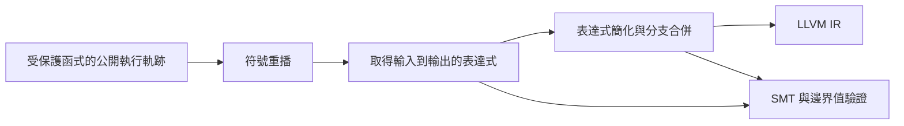

# VMProtect 虛擬化與語義還原研究

本課題研究 VMProtect 虛擬化後的函式，如何透過執行軌跡與符號執行恢復可閱讀、可驗證的輸入輸出邏輯。第一階段以四組公開研究案例建立基準，交付可重現命令、還原的 LLVM IR、編譯後的目的檔與驗證記錄，後續再擴充自行產生樣本及錄製軌跡。

最新的 [還原可靠性研究報告](REPORT.md) 整理旗標處理消融、上游結果的獨立編譯比較，以及本地原生呼叫參數映射問題；逐步執行紀錄見 [RESULTS.md](RESULTS.md)。

後續的 [相關研究比較與 MBA 案例擴充](EXTENSION_REPORT.md) 加入第五組 sample3，驗證低 8 位元結果並窮舉全部 65,536 組位元組輸入。最新一鍵流程包含此案例。

[Tigress VM 挑戰研究評估](TIGRESS_ASSESSMENT.md) 保留啟動前的可行性分析；後續已實作 ELF 模擬、自動路徑探索及 VM-0 五個樣本的語義還原，結果見 [Tigress 實驗報告](TIGRESS_REPORT.md)。Tigress 與 VMP 案例分開統計。

接續的 [Tigress C 函式重建報告](TIGRESS_C_REPORT.md) 把五個樣本的還原 IR 轉成 C，實際編譯為目的檔並比對執行結果。此階段尚未證明原始迴圈與資料結構已恢復；入口為 `start_tigress_c.ps1`。

## 研究問題

1. 哪些虛擬機執行細節能透過輸入依賴分析消除，留下目標函式的語義？
2. 含條件分支的函式，如何從不同路徑的軌跡識別分支並合併結果？
3. 暫存器、記憶體與 CPU 旗標的同步策略，會如何影響還原結果的正確性？

「還原」的第一階段定義為取得與受分析函式等價的表達式及 LLVM IR；評估範圍為所建立的機器語義模型。完整 EXE 重建、通用 VMProtect 解保護工具與原始變數名稱恢復不屬於本階段交付。

## 虛擬化機制與研究方法

VMProtect 將原生程式碼轉換為自訂位元組碼，由嵌入受保護程式的虛擬機執行。研究時應觀察虛擬機狀態、指令處理函式及分派過程。[VMProtect 官方手冊](https://www.vmpsoft.com/vmprotect/user-manual)

本階段採用 Jonathan Salwan 公開研究的動態分析路線，利用既有 trace 建立符號表達式，再消除不依賴輸入的運算並輸出 LLVM IR。多路徑需另外檢查各路徑條件及合併表達式；單條 trace 的成功不能直接推廣為任意函式的完整還原。[原作者研究](https://github.com/JonathanSalwan/VMProtect-devirtualization)



## 公開案例

固定來源版本為 `JonathanSalwan/VMProtect-devirtualization` 的 commit `d2b26d66db59e341f179c7e326246d28c4d25491`。案例包含原始 C、作者的 trace 及受保護 ELF。下載的 ELF 僅作為研究材料保存，本輪執行的是本地符號重播工具。

| 案例 | 原始邏輯摘要 | 研究重點 |
|---|---|---|
| sample2 | `x ^ y` | 位元運算、表達式簡化、LLVM 輸出 |
| sample4 | 有號 `x >= y ? x : y` | 有號邊界、SF 與 OF、多路徑合併 |
| sample5 | `x + y == 1001 ? x + 1 : y - 1` | 等值分支、路徑互補、32 位元回繞 |
| sample6 | 無號 `x + y < 1234 ? x + 1 : y - 1` | 無號比較及加法回繞 |

source 與 trace 按既有 `fetch_samples.py` 記錄的 SHA-256 驗證。ELF 採用固定 commit URL，並將首次下載的本地實測 SHA-256 固定在研究入口；此雜湊不是另一個獨立來源的認證。重跑時核對預期雜湊，遇到不同內容即停止。

逐檔來源、位元組數與 SHA-256 見執行後的 `generated/downloads.tsv`。原作者程式與材料保留來源歸屬；公開再散布前須另外核對適用授權。

## 執行方式

在倉庫根目錄一鍵執行；入口自動建立缺少的 Python 3.11 虛擬環境、補齊固定版本依賴，並執行下載、還原、驗證、原生編譯及產物打包：

```powershell
& VMP/research/start.ps1
```

使用已安裝依賴的研究環境也可直接執行：

```powershell
& VMP/.venv/Scripts/python.exe -u VMP/research/run.py
```

只下載材料：

```powershell
& VMP/.venv/Scripts/python.exe -u VMP/research/run.py --download-only
```

若環境需要重建，使用 Python 3.11：

```powershell
py -3.11 -m venv VMP/.venv
& VMP/.venv/Scripts/python.exe -m pip install -r VMP/research/requirements.txt
& VMP/.venv/Scripts/python.exe -u VMP/research/run.py
```

依賴為 `triton-library==1.0.0rc4` 及 `llvmlite==0.46.0`，須有相容的 Python 與作業系統 wheel。前者與 GPU 編譯用途的同名 `triton` 套件不同。

研究入口會依序下載與核對案例、還原 sample2、合併 sample4 至 sample6，執行重播、分支合併及流程失敗處理測試，最後將還原 IR 最佳化、編譯及執行比對。個案分析使用本目錄的下載資料；回歸測試使用合成符號表達式，不需原單元的輸入目錄。

每次執行建立獨立的 `generated/runs/<UTC時間>/`，保存本次環境、材料雜湊、日誌和產物，並更新 `RESULTS.md`。個案失敗時保留日誌並傳回非零退出碼，未成功的舊產物不列入本次成功結果。單一步驟超過 600 秒會記錄為失敗。

## 檔案與交付

| 路徑 | 用途 |
|---|---|
| `PROJECT.md` | 課題目標、範圍、方法與研究計畫 |
| `run.py` | 下載、還原與驗證入口 |
| `start.ps1` | Windows 一鍵環境檢查、依賴安裝及執行入口 |
| `native_verify.py` | LLVM 最佳化、原生編譯與獨立模型比對 |
| `robustness.py` | 旗標處理消融、上游 IR 編譯及符號分類證明 |
| `REPORT.md` | 自動產生的可靠性研究報告 |
| `RESULTS.md` | 本次實測報告，由成功完成的執行流程產生 |
| `inputs/` | 下載的 C、trace、參考腳本與 ELF，不加入 Git |
| `generated/downloads.tsv` | 下載來源與雜湊清單 |
| `generated/runs/<時間>/xor/` | XOR 還原 IR、表達式及驗證報告 |
| `generated/runs/<時間>/multipath/` | 三組分支函式的還原 IR 與驗證報告 |
| `generated/runs/<時間>/native/` | 最佳化 IR、原生組合語言、目的檔與比對記錄 |
| `generated/runs/<時間>/robustness/` | 消融差異、逐案記錄、上游 IR 及結果資料 |
| `generated/runs/<時間>/test_*.txt` | 回歸測試輸出 |
| `generated/runs/<時間>/research_bundle.zip` | 本次報告、日誌、原生產物及研究入口副本；重跑仍需本倉庫的還原工具 |

## 驗證設計

每個案例先檢查輸入材料的雜湊，再驗證還原表達式與參考模型。SMT 查詢「兩者是否存在不同輸出的輸入」；UNSAT 表示在指定模型與假設下無反例，UNKNOWN 或錯誤均不算通過。

多路徑額外檢查條件互補、各路徑條件下的結果，以及合併函式的等價性。邊界及隨機值測試補充檢查求值流程。機器碼的 32 位元回繞模型須與 C 語言的有號溢位規則分開解讀。

原生驗證以 llvmlite 對還原 IR 執行 O3 最佳化，輸出目的檔及組合語言，並以 JIT 編譯後的函式進行 40,912 組實際呼叫。sample2 與 sample4 各 10,100 組，sample5 與 sample6 各 10,356 組；後兩者額外產生稀有分支的輸入。有限測試補充編譯流程檢查，不替代 SMT 證明。[編譯官方範例](https://llvmlite.readthedocs.io/en/v0.46.0/user-guide/binding/examples.html)、[最佳化官方說明](https://llvmlite.readthedocs.io/en/v0.46.0/user-guide/binding/optimization-passes.html)

這一輪重現沿用倉庫既有的還原器與模型，是研究基準；四個已知樣本的成功不能視為對未知 VMP 程式的通用能力，也不能把參考 C 當作待還原工具的輸入答案。後續獨立案例應在分析完成後才揭示參考結果。

## 後續研究與驗收

| 階段 | 工作 | 驗收條件 |
|---|---|---|
| 基準重現 | 下載四組案例並執行既有工具 | 四組個案、回歸測試及可追溯來源記錄 |
| 機制分析 | 選一段 trace 標註虛擬機狀態及資料依賴 | 能說明一個輸出如何從輸入推導 |
| 獨立樣本 | 以可用的 VMProtect 環境保護自行撰寫的函式，錄製新 trace | 有原始程式、保護配置、版本與錄製命令 |
| 方法擴充 | 從新增運算、記憶體存取或迴圈中選一項 | 新案例、失敗案例及改進前後比較 |
| 研究報告 | 整理方法、實驗、限制與貢獻 | 結果可重跑，引用與原創改進可區分 |

獨立樣本階段需確定可用的 VMProtect 版本及授權環境、目標平台與 trace 錄製工具。目前公開 trace 的目標是 Linux x64 SysV，Windows 上的重播不等於 Windows 原生樣本的錄製。

2026 年 11 月 22 日本機檢查結果：可用 Python 3.11 與 Triton；WSL 尚未安裝，在常見安裝位置未找到 VMProtect。當前自動化流程已涵蓋公開案例至還原函式的本機執行；獨立加保護與新 trace 錄製仍需另行建立環境。

評估指標包括 trace 指令數、分析耗時、LLVM 指令數、成功證明的案例數與路徑覆蓋。trace 長度和還原 IR 長度代表不同工作量，不能直接解讀為執行效能加速倍數。

## 參考資料

- [VMProtect 官方手冊](https://www.vmpsoft.com/vmprotect/user-manual)
- [固定版本的公開研究倉庫](https://github.com/JonathanSalwan/VMProtect-devirtualization/tree/d2b26d66db59e341f179c7e326246d28c4d25491)
- [本倉庫 VMP 實驗總覽](../README.md)
- [單路徑題解](../02_vmp_trace/writeup.md)
- [多路徑題解](../03_multipath/writeup.md)
